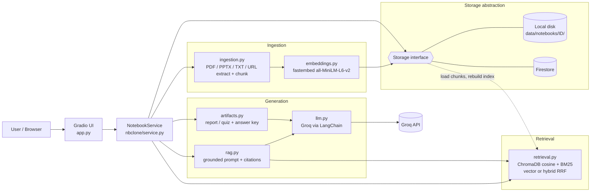

# Architecture

## Diagram



Deployment: `git push` → **GitHub Actions** (pytest) → deploy hook → **Render** (Docker web service) → Gradio app
→ Groq API (LLM) + Firestore (persistence). Secrets live in GitHub Secrets / Render env vars, never in the repo.

## Modules

| Module | Responsibility |
|---|---|
| `app.py` | Gradio UI only: notebook manager, uploads, URL ingest, chat + citations, artifact buttons/viewer/download, error toasts. No business logic. |
| `nbclone/service.py` | `NotebookService` facade: notebook CRUD, ingestion pipeline, chat, artifacts. Single entry point for the UI and tests. |
| `nbclone/ingestion.py` | Text extraction (pypdf, python-pptx, plain text, requests+BeautifulSoup) with page/slide tracking, SSRF-safe URL fetch, chunking (`RecursiveCharacterTextSplitter`, 800/100, per page/slide). |
| `nbclone/embeddings.py` | Lazy-loaded fastembed (ONNX) embedder, 384-dim MiniLM vectors, no PyTorch. |
| `nbclone/retrieval.py` | Per-notebook index. `vector`: Chroma cosine search. `hybrid`: vector + BM25 fused with Reciprocal Rank Fusion. |
| `nbclone/rag.py` | Builds the grounded prompt (numbered sources + `[n]` citation rule), times retrieval/LLM, builds citation records. |
| `nbclone/artifacts.py` | Report and quiz generation from evenly-sampled chunks (bounded prompt size); guarantees an `## Answer Key`. |
| `nbclone/llm.py` | Groq/LangChain client, hidden reasoning traces, retry/backoff on rate limits, friendly errors. |
| `nbclone/storage/` | `Storage` interface + `LocalStorage` and `FirestoreStorage` backends, chosen by `STORAGE_BACKEND`. |
| `eval/run_eval.py` | Reproducible vector-vs-hybrid evaluation producing `docs/RAG_EVALUATION.md`. |

## Data flow

**Ingest:** file/URL → extract text (keeping page/slide) → chunk → embed → `Storage.add_chunks/add_source/save_raw/save_extracted` → in-memory index invalidated.

**Chat:** question → `NotebookIndex.search(mode)` (rebuilt from stored chunks if not in memory) → top-5 chunks → grounded prompt → Groq → answer with `[n]` markers → citations (source, page/slide, snippet, score) → both messages saved to storage.

**Artifacts:** all chunks → sampled to ≈9,000 chars → report/quiz prompt → Groq → Markdown saved as an artifact → viewable in the UI and downloadable as `.md`.

## Notebook storage

Each notebook has a unique 12-hex id; sources, chunks, messages and artifacts are always stored under that id.

```
data/notebooks/<id>/            (LocalStorage)
  meta.json  sources.json  chunks.json  messages.json  artifacts.json
  raw/<uploaded files>   extracted/<source>.txt   artifacts/<id>.md
```
```
notebooks/{id}  ──  sources/{sid}  chunks/{seq}  messages/{ts}  artifacts/{aid}     (FirestoreStorage)
```

The vector index (ChromaDB, in memory) is a *derived* structure rebuilt from the persisted chunks and embeddings on first use
after a restart, so persistence is identical for both backends. `LocalStorage` validates ids (no path traversal) and writes JSON atomically.

**Persistence limits:** Render's disk is ephemeral, so production uses `STORAGE_BACKEND=firestore`. Firestore keeps metadata, chunks (text + embedding),
chats and artifacts; original uploaded binaries are not stored there (extracted text is, inside chunks). Local mode keeps everything including raw files.

## RAG pipeline

1. Extract → 2. chunk (800 chars, 100 overlap, never crossing a page/slide) → 3. embed (MiniLM-L6-v2) → 4. index (Chroma cosine + BM25) →
5. retrieve top-k (vector or hybrid/RRF) → 6. grounded prompt → 7. LLM answer → 8. citations. Two retrieval methods are compared in `docs/RAG_EVALUATION.md`.

## Design decisions

- **Storage abstraction** so the same service code runs on laptop disk and Firestore.
- **Index rebuilt from stored chunks** → no vector-DB hosting needed, survives cold starts.
- **fastembed instead of PyTorch** → fits small Render instances and builds quickly.
- **Bounded artifact context** → predictable token usage on rate-limited free LLM tiers.
- **Deploys gated on tests**: the deploy job only runs after `pytest` passes.
- **Embeddings stored as packed float32 bytes in Firestore**, not arrays. Firestore auto-indexes every array element
  (384 per chunk), which made ingesting a 124-chunk PDF take 12.8 s of writes. As bytes, the write takes 0.6 s and reads
  take 0.1 s (measured), with negligible precision loss (~3e-8). Similarity search never runs in Firestore, so nothing is lost.
- **Sources ingest on upload / Enter**, without a separate "Add" click, so a dropped file can't be silently left un-ingested.
- **Embedding tuned for a 512 MB instance.** fastembed's defaults (batch 256, one ONNX thread per host core, memory
  arena on) peaked at 2.3 GB while embedding a ~500-chunk document, and Render OOM-killed the free instance. With batch 8,
  1 thread and the arena off, the whole app peaks at 365 MB for the same document (measured). The free plan only has
  0.1 CPU, so extra threads never helped there. `MALLOC_ARENA_MAX=2` in the Dockerfile limits glibc heap fragmentation.
